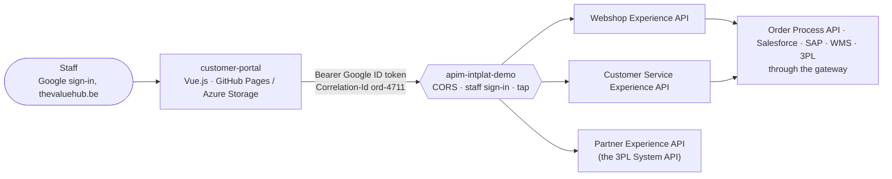

# customer-portal

The **customer portal** of the integration platform demo, in **Vue.js**: the webshop, customer
service and the 3PL partner, on the platform's Experience APIs. Owned by the **channel team**
([ADR 0017](https://github.com/azure-intelligence-domain/ai-intelligence-domain/blob/main/docs/adr/0017-experience-layer-and-staff-sign-in.md)).

- **GitHub Pages:** https://azure-intelligence-domain.github.io/customer-portal/
- **Azure:** https://stportalintplatdemo.z50.web.core.windows.net (Storage static website, Belgium Central)

Sign-in is **Google, for `thevaluehub.be` accounts only**: the Google OAuth client is *Internal*
to the Workspace, and the gateway validates every call's Google ID token (audience = the
portal's client, `hd` = the staff domain). Everyone signed in is staff and sees every customer.

## What you can do

| Area | Screen | Experience API |
|---|---|---|
| Webshop | Shop for a customer (ACME, Globex, …): the catalogue with prices, a cart, delivery address and date | Webshop: products, customers, Place Order |
| Webshop | Orders, filtered by customer and status | Webshop: Retrieve List of Orders |
| Webshop | One order, live: progress, every domain's facts on a timeline, invoices (pay), the shipment (tracking), cancel, change address | Webshop: Retrieve Order, Cancel Order, Change Delivery Address, Pay Invoice |
| Customer service | Customers, a customer at a glance (orders by status, what it owes), any order with what SAP, the warehouse and the 3PL know; hold, release, reschedule, change address, cancel | Customer Service |
| 3PL partner | You play speedy-3pl: the bookings to pick up, the shipments out for delivery; report pick-ups and deliveries | Partner |



Every call carries a `Correlation-Id`: `ord-<orderId>` for everything about one order, so the
portal's clicks, the gateway, the order domain and SAP, the warehouse and the 3PL are one journey
in the tap and one trace in Application Insights. A new order's journey starts as `web-<random>`.

## The story on stage

1. **Shop** for ACME: 12 × Hydraulic Press HP-1042 (€84,000), place the order.
2. The order page follows it **live**: SAP accepts it (credit check) and invoices it, the
   warehouse reserves the stock, the 3PL books the shipment: each fact appears on the timeline.
3. As the **3PL partner**, report the pick-up: the order is shipped; then the delivery.
4. Back on the order, **pay** the invoice: the order is paid and completed.
5. Place another and **cancel** it while it waits for the truck: SAP credits the invoice, the
   warehouse releases the stock, the 3PL cancels the booking, all by events.
6. Above €250,000, SAP's credit check **refuses** the order.

## Run it locally

```sh
npm install
npm run dev     # http://localhost:5173 (an authorised origin of the Google client and the gateway's CORS)
npm test
```

Settings are public and live in [`.env`](.env): the gateway URL, the Google OAuth client id, the
staff domain. Nothing secret is in this repository; the Google client has no secret in use (the
portal receives an ID token).

## Code

| Path | What |
|---|---|
| [`src/lib/api.js`](src/lib/api.js) | The three Experience APIs, with the sign-in and the journey on every call |
| [`src/lib/auth.js`](src/lib/auth.js) | Google sign-in (Google Identity Services), kept for this browser tab only |
| [`src/lib/useOrder.js`](src/lib/useOrder.js) | One order on screen, refreshed while it moves by events |
| [`src/views/`](src/views/) | Shop, Orders, OrderPage, Support, Customer, SupportOrder, Partner, SignIn |
| [`src/components/`](src/components/) | Progress track, fact timeline, invoices, shipment, … |
| [`infra/main.bicep`](infra/main.bicep) | The Storage static website |
| [`.github/workflows/portal.yml`](.github/workflows/portal.yml) | Test, build, publish on Pages and Azure, smoke tests, deployment event |
